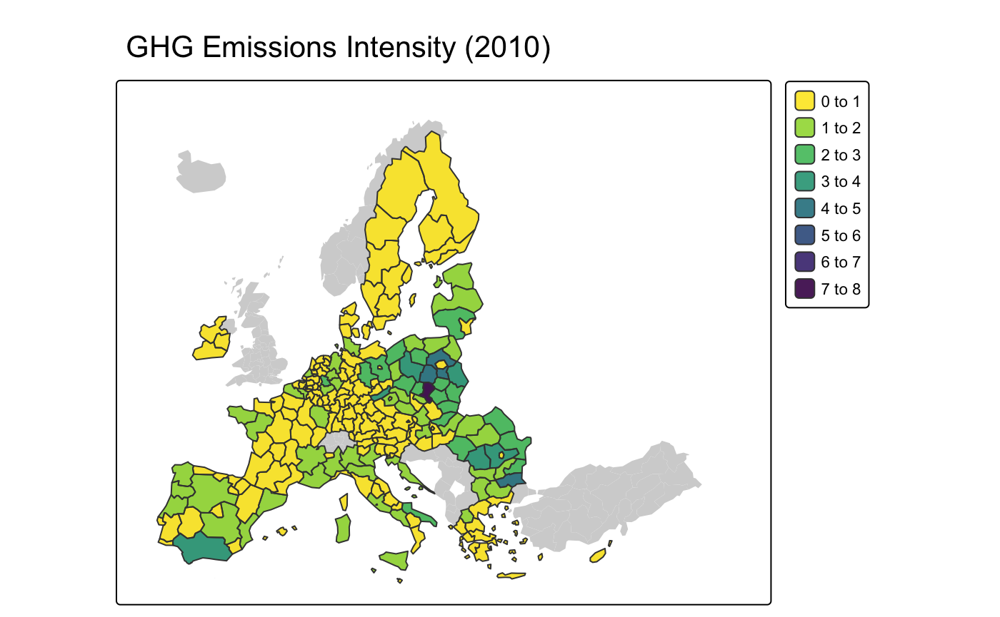
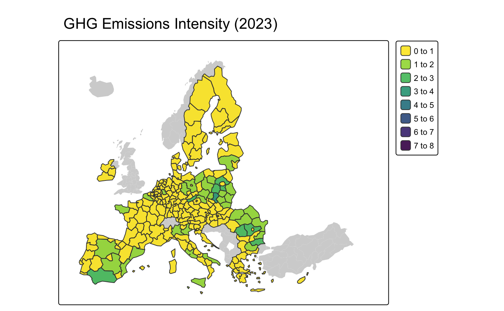
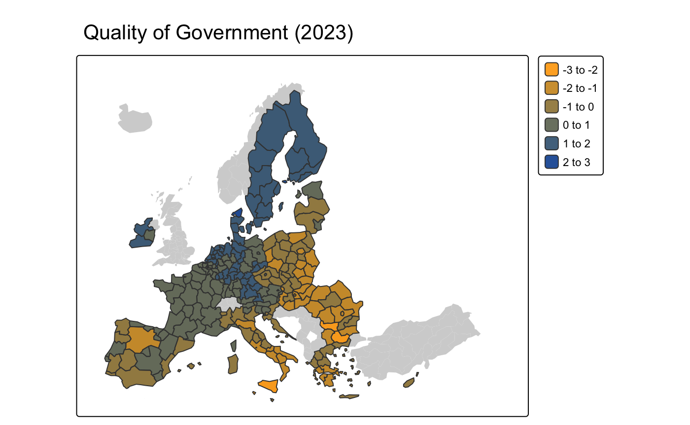
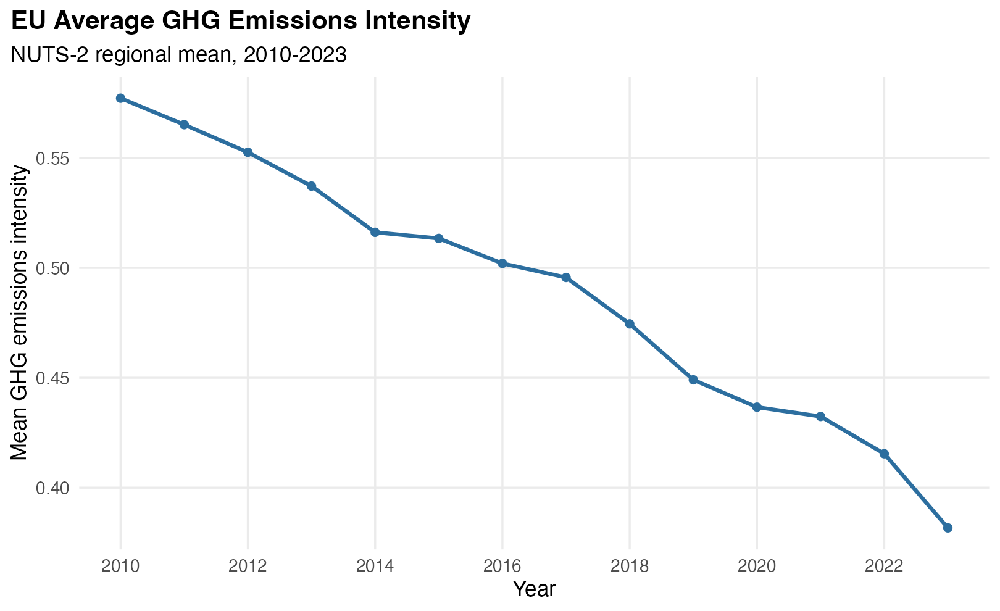
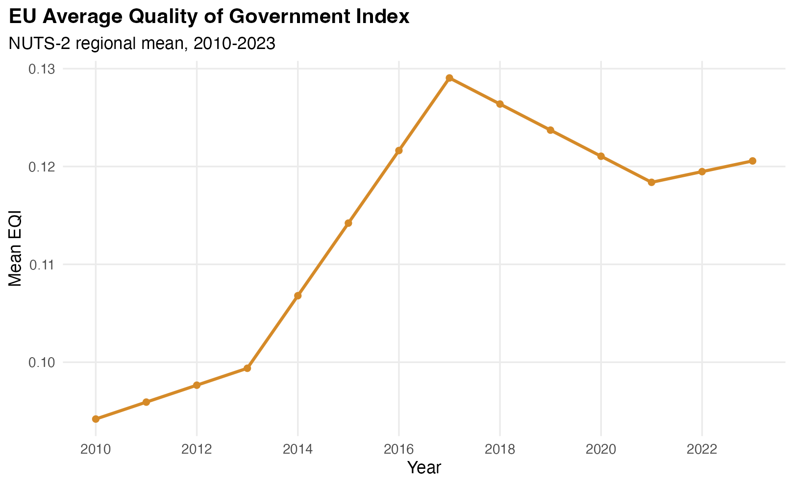
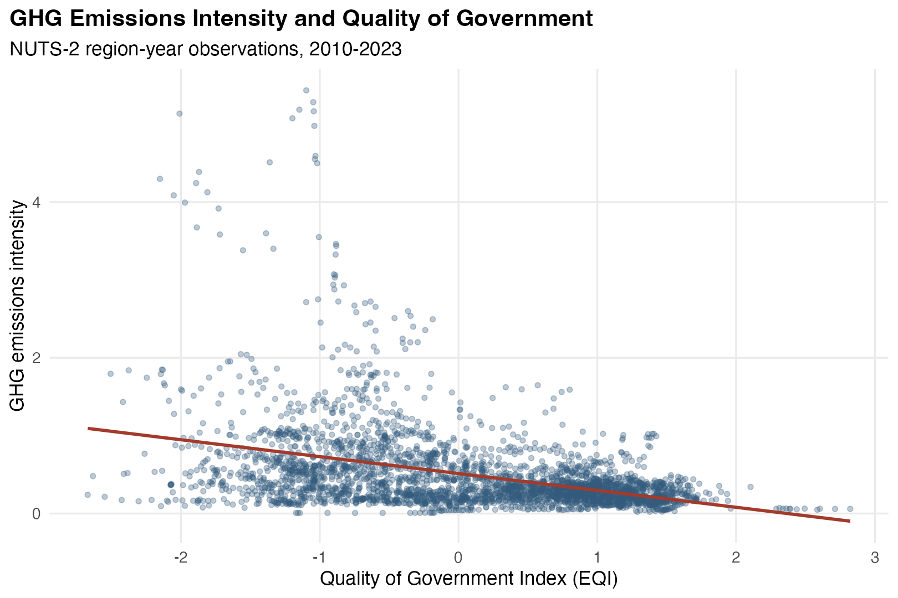
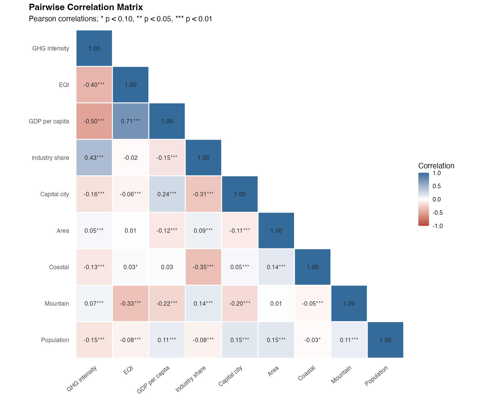

# Government Quality and Environmental Performance in European Regions

> **Master's Thesis Research.** The subject is regional
> environmental performance, while the analytical workflow follows the same
> sequence used in product analytics: define a metric, formulate a hypothesis,
> segment observations, analyse trends, test the relationship, and communicate
> limitations.

## Project at a glance

| Element | Definition |
| --- | --- |
| Research Question | Is regional government quality associated with greenhouse gas emissions intensity? |
| Primary metric | `GHG_per_GDP`: greenhouse gas emissions per unit of regional GDP |
| Main explanatory metric | `EQI_interp`: interpolated European Quality of Government Index |
| Unit of analysis | NUTS-2 region-year |
| Coverage | 240 European regions, 2010-2023 |
| Sample size | 3,360 observations |
| Hypothesis | Regions with higher government quality tend to have lower emissions intensity |
| Methods | Data integration, metric construction, segmentation, trend analysis, correlation analysis, pooled OLS, Fixed Effects, LSDV, and Hausman tests |
| Main reported result | The EQI coefficient is negative and statistically significant in the Fixed Effects specifications reported in Table 6 |
| Main limitation | The data are observational; the results describe an association and do not by themselves establish causality |

## Analytical skills demonstrated

| Product analytics task | Evidence in this project |
| --- | --- |
| Problem framing | A broad environmental question is translated into a testable region-level hypothesis |
| Metric definition | Absolute emissions are normalised by GDP to make regions more comparable |
| Data preparation | Multiple regional sources are joined using NUTS codes and years |
| Missing-data treatment | EQI values between survey waves are interpolated to construct an annual panel |
| Segmentation | Results are compared across regions, years, and European subregions |
| Trend analysis | Annual averages are tracked from 2010 through 2023 |
| Exploratory analysis | Summary statistics, maps, scatter plots, and a correlation matrix are used to identify patterns |
| Hypothesis testing | The EQI-emissions relationship is evaluated using panel regressions |
| Model selection | Fixed and Random Effects are compared with a Hausman test |
| Critical interpretation | Statistical associations, model assumptions, and data limitations are stated explicitly |
| Communication | Findings are presented through concise tables, maps, and reproducible R visualisations |

## Metric framework

- **Outcome metric:** `GHG_per_GDP`, the amount of greenhouse gas emissions
  generated per unit of economic output.
- **Main explanatory metric:** `EQI_interp`, the annual regional government
  quality score.
- **Economic controls:** GDP per capita and industrial share.
- **Demographic control:** population.
- **Geographical controls:** area, coastal region, mountainous region, and
  capital-city region.
- **Segments:** region, country, European subregion, and year.

The descriptive stage asks whether the variables move together. The regression
stage tests whether the relationship remains after accounting for observed
regional characteristics, common time effects, and unobserved time-invariant
regional heterogeneity.

## Analysis workflow

```text
EQI + EDGAR + Eurostat source data
                  |
                  v
       Cleaning and NUTS harmonisation
                  |
                  v
       Region-year analytical panel
                  |
                  v
    Metric construction and data checks
                  |
                  v
  Trends, maps, segments, and correlations
                  |
                  v
       Panel regression specifications
                  |
                  v
       Interpretation and limitations
```

## Case context

This project investigates whether regional variations in government quality
explain differences in environmental outcomes. Using panel data from 240
NUTS-2 European regions between 2010 and 2023, the study estimates the effect
of institutional quality, measured by the European Quality of Government Index
(EQI), on greenhouse gas emissions intensity.

The regional level is central to the analysis because NUTS-2 regions are the
primary units for the allocation of EU cohesion policy funds, which aim to
reduce regional disparities and facilitate the green transition. Annual EDGAR
data make it possible to compare emissions at the regional level over a period
that includes the launch of the European Green Deal and other major climate and
governance initiatives.

## Research design

GHG Emissions Intensity is measured as greenhouse gas emissions per unit of GDP.
It captures environmental performance in terms of emissions efficiency rather
than absolute emissions. Normalizing emissions by GDP improves comparability
between regions that differ in size and level of development.

EQI is a composite regional indicator based on three dimensions of public-sector
governance: impartiality, control of corruption, and the quality of public
services. EQI observations are available for 2010, 2013, 2017, 2021, and 2023.
The missing years between these observations are filled using linear
interpolation.

The analysis also includes regional economic, demographic, and geographical
controls: GDP per capita, industrial share, area, coastal and mountainous-region
indicators, a capital-city indicator, and population.

## Descriptive evidence

The descriptive statistics indicate substantial heterogeneity in both
government quality and emissions performance across European regions. Regions
with higher government quality tend to be more environmentally efficient.

### Summary statistics

| Variable | Mean | SD | Minimum | Maximum |
| --- | ---: | ---: | ---: | ---: |
| GHG Emissions Intensity | 0.489 | 0.530 | 0.008 | 5.434 |
| EQI | 0.113 | 0.980 | -2.672 | 2.822 |
| GDP per capita | 27,113.150 | 14,493.324 | 3,721.000 | 106,642.000 |
| Industrial share | 21.790 | 9.372 | 4.340 | 77.190 |
| Capital city | 0.100 | 0.300 | 0.000 | 1.000 |
| Area | 17,099.804 | 21,487.561 | 162.000 | 203,900.000 |
| Coastal | 0.467 | 0.499 | 0.000 | 1.000 |
| Mountain | 0.462 | 0.499 | 0.000 | 1.000 |
| Population | 1,848,498.622 | 1,605,036.578 | 27,734.000 | 12,388,388.000 |

The highest GHG emissions intensity in the sample is observed in Dytiki
Makedonia, Greece, in 2012, while the lowest is observed in Mayotte, France, in
2022.

### Regional distribution of GHG emissions intensity

| 2010 | 2023 |
| --- | --- |
|  |  |

In 2010, the highest GHG emissions intensity scores are concentrated in Eastern
European regions, particularly Poland, Romania, Bulgaria, Hungary, and the
Baltic countries. Elevated values are also observed in Greece and parts of
Portugal and Spain. Northern and Western European regions display comparatively
low intensity levels.

By 2023, the overall spatial distribution remains consistent with 2010, while
intensity levels have generally declined across the European Union. Eastern
Europe remains the area with the highest emissions intensity. Several Spanish
and Italian regions improve, while Greece continues to show relatively high
intensity. Low-emitting regions in Northern and Western Europe remain largely
stable.

### Regional distribution of government quality

| 2010 | 2023 |
| --- | --- |
|  |  |

In 2010, the highest EQI scores are observed in the Nordic countries, followed
by Western European regions such as the Netherlands, parts of Germany, and
Austria. Eastern Europe, the Baltic countries, Southern Italy, and Greece show
the lowest institutional quality.

By 2023, the overall ranking remains relatively stable. Northern and Western
European regions remain the highest performers, while German regions show major
improvements. Some Eastern European regions move to a higher quartile, but low
EQI persists across much of Romania, Bulgaria, and Hungary. The stability of
the distribution is consistent with government quality being a slow-moving
factor, whereas GHG emissions intensity changes more dynamically.

The pairwise correlation between EQI and GHG emissions intensity is -0.40 and
is statistically significant at the 1% level. This descriptive relationship
does not account for omitted-variable bias and is interpreted as preliminary
evidence rather than a causal estimate.

### Average trends, 2010-2023

| GHG emissions intensity | Quality of Government Index |
| --- | --- |
|  |  |

At the EU level, average GHG emissions intensity declines steadily between 2010
and 2023, while the average Quality of Government Index shows moderate growth.
The two trends do not align perfectly, but the pattern is consistent with the
aggregate evidence described in the thesis.

### EQI and GHG emissions intensity



The scatter plot shows the negative association between the two variables. The
pairwise correlation is -0.40 and statistically significant at the 1% level.
As stated in the thesis, this relationship does not control for omitted-variable
bias and should be treated as preliminary.

### Pairwise correlation matrix



The matrix reproduces the descriptive relationships reported in Table 4. GHG
emissions intensity is positively correlated with industrial share and
negatively correlated with EQI, GDP per capita, the capital-region indicator,
and population.

## Main results: Fixed Effects and LSDV models

Table 6 reports Fixed Effects (FE) and Least Squares Dummy Variable (LSDV)
models. Models 1 and 2 use the standard within transformation. Models 3 and 4
are LSDV regressions that include region-specific dummy variables explicitly.

|  | Model 1 | Model 2 | Model 3 | Model 4 |
| --- | ---: | ---: | ---: | ---: |
| EQI | -0.0313\*\*\*<br>(0.0115) | -0.0246\*\*<br>(0.0105) | -0.0313\*\*\*<br>(0.0115) | -0.0246\*\*<br>(0.0105) |
| GDP per capita | -0.0000\*\*\*<br>(0.0000) | -0.0000\*\*\*<br>(0.0000) | -0.0000\*\*\*<br>(0.0000) | -0.0000\*\*\*<br>(0.0000) |
| Industry share | 0.0107\*\*\*<br>(0.0011) | 0.0059\*\*\*<br>(0.0010) | 0.0107\*\*\*<br>(0.0011) | 0.0059\*\*\*<br>(0.0010) |
| Capital city |  |  | -1.6176\*\*\*<br>(0.1627) | -1.7347\*\*\*<br>(0.1489) |
| Area (km²) |  |  | -0.0009\*\*\*<br>(0.0001) | -0.0009\*\*\*<br>(0.0001) |
| Coastal |  |  | -5.5766\*\*\*<br>(0.5836) | -5.5589\*\*\*<br>(0.5339) |
| Mountain |  |  | 10.3741\*\*\*<br>(1.1037) | 10.4634\*\*\*<br>(1.0097) |
| Population | 0.0000\*\*\*<br>(0.0000) | 0.0000\*\*\*<br>(0.0000) | 0.0000\*\*\*<br>(0.0000) | 0.0000\*\*\*<br>(0.0000) |
| R² Overall | 0.101 | 0.252 | 0.951 | 0.959 |
| R² Within | 0.030 | 0.375 |  |  |
| R² Between | 0.230 | 0.183 |  |  |
| Observations | 3,360 | 3,360 | 3,360 | 3,360 |
| Year effects | No | Yes | No | Yes |
| Hausman test, p-value | 0.0000 | 0.0000 |  |  |

*Dependent variable: GHG Emissions Intensity. Geographically clustered
standard errors are shown in parentheses. \* p < 0.1, \*\* p < 0.05,
\*\*\* p < 0.01.*

The EQI coefficient is negative and statistically significant in Models 1 and
2. When year effects are included, its magnitude declines from -0.0313 to
-0.0246. The within R² rises from 0.030 to 0.375, indicating the importance of
capturing time effects common to European regions.

Models 3 and 4 reproduce the first two specifications using the LSDV approach,
which retains time-invariant regional variables. The capital-city and coastal
indicators are negative and statistically significant; the mountain indicator
is positive; and area is negative and statistically significant. The two LSDV
models explain approximately 95% of the variation.

For Models 1 and 2, the Hausman test yields a p-value below 0.001. The null
hypothesis that unobserved region-specific effects are uncorrelated with the
explanatory variables is therefore rejected in favor of the Fixed Effects
specification.

## Limitations

- EQI is observed only in 2010, 2013, 2017, 2021, and 2023. Values for the
  intervening years are linearly interpolated.
- The study uses observational regional data. The estimated coefficients do not
  by themselves prove a causal effect.
- Regional indicators from several sources require harmonisation across NUTS
  classifications.
- The findings apply to the analysed European NUTS-2 regions and the 2010-2023
  period.
- Fixed Effects account for time-invariant regional heterogeneity, but other
  time-varying omitted factors may still affect the estimates.

## Reproducibility

The analysis and visualisations are written in R. The figure-generation script
checks its package dependencies and validates that the final panel contains the
variables required for the analysis.

```bash
TFM_RDATA_PATH=/path/to/thesis-workspace.RData \
  Rscript R/generate-descriptive-figures.R
```

Required R packages:

```r
install.packages(c("dplyr", "ggplot2", "tidyr"))
```

The script regenerates the annual metric tables, correlation matrix, trend
charts, scatter plot, and correlation heatmap used in this README.

## Repository structure

```text
government-quality-ghg-eu/
├── README.md
├── government-quality-ghg-eu.Rproj
├── R/
│   └── generate-descriptive-figures.R
├── data/
│   └── README.md
├── figures/
│   ├── regional maps
│   ├── annual trends
│   ├── EQI-GHG scatter plot
│   └── correlation matrix
└── tables/
    ├── annual-means.csv
    ├── correlation-matrix.csv
    └── table-6-fixed-effects.csv
```

## Scope of this repository

This repository presents the descriptive part and the principal Fixed Effects
results of the master's thesis *Effect of Government Quality on Environmental
Performance*. The wording, statistics, interpretations, and reported findings
on this page are based exclusively on the thesis, especially Chapters 3 and 5
and Table 6. The text has only been shortened and formatted for a GitHub project
page.
